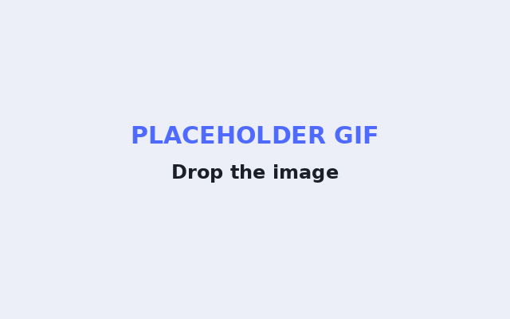
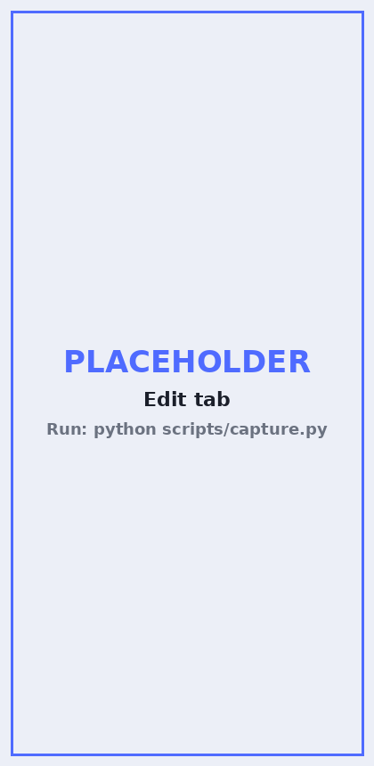
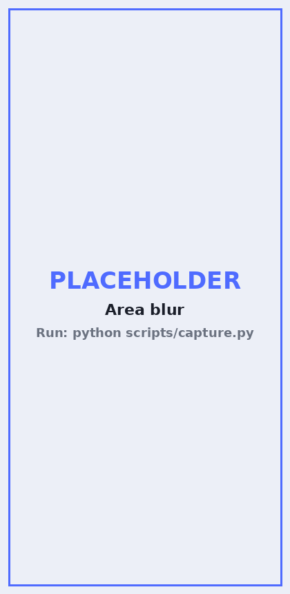
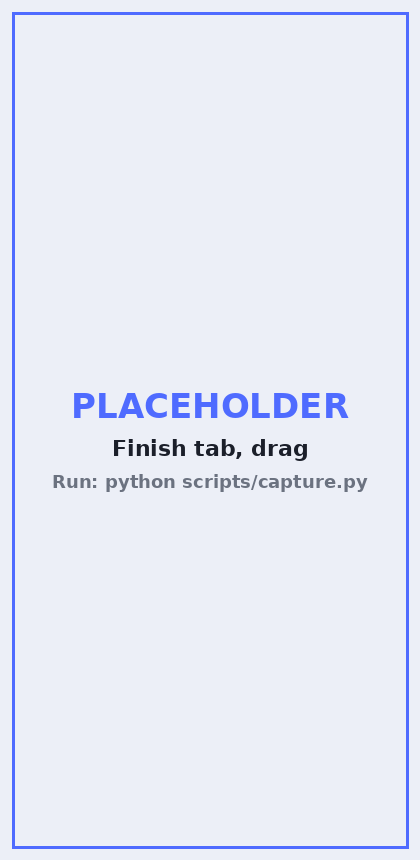
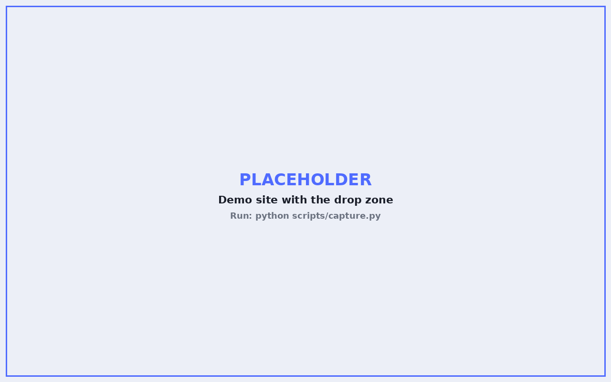

<div align="center">

# ImagePad

**Prepare images for upload, right beside the page you are on.**

Part of **WUDp** by **TGO.tools**




<sub>The GIF above is a placeholder. Replace it with a real recording (see [Capturing screenshots](#capturing-screenshots)).</sub>

</div>

---

## The story (فارسی)

خیلی وقت‌ها می‌خواهی یک عکس را در یک سایت بارگذاری کنی، اما یک تغییر کوچک لازم است: کادر را تنظیم کنی، یک چهره را محو کنی، یا حجم عکس را پایین بیاوری. برای یک کار کوچک، باز کردن یک نرم‌افزار بزرگ عملاً زحمت زیادی دارد.

**ImagePad** برای همین ساخته شد. کنار همان سایت، در پنل کناری مرورگر اجرا می‌شود. با سختی و پیچیدگی کم، شکل یا حجم عکس را تغییر می‌دهی و همان را در سایت اصلی استفاده می‌کنی، بدون اینکه از مرورگر خارج شوی و بدون اینکه عکس جایی آپلود شود.

---

## What it does

- **Crop** to a free area, or to common site frames: profile photos, square and portrait posts, stories, video thumbnails, banners and more. In a fixed frame, the image moves under the frame, so you choose what stays inside.
- **Blur, pixelate or cover** a rectangle or an ellipse, or paint the same effects with a brush.
- **Watermark** with text, in a corner or tiled over the whole picture.
- **Output** as JPEG, WebP or PNG, with quality, a maximum file size and a maximum pixel size.
- **Metadata**: removed by default (camera, date, GPS). You can keep it for JPEG files when you need it.
- **Send it**: drag the finished image straight into a page, copy it as PNG, or save it.
- **Private**: nothing is uploaded. No analytics, no account.
- **Guided tour** on the first start, and a demo image so every step points at a real control.
- **Settings**: language (English, Русский, فارسی, 中文), theme (Modern, Dark, Luna XP), larger controls, hints, reduced motion, start tool and start view.

## Screenshots

| Edit | Area blur | Finish and drag |
| :---: | :---: | :---: |
|  |  |  |



<sub>All images in `docs/images/` are placeholders until you capture real ones (see [Capturing screenshots](#capturing-screenshots)).</sub>

---

## Install

### From the stores

| Store | Download |
| --- | --- |
| Chrome Web Store | Coming soon |
| Microsoft Edge Add-ons | Coming soon |
| Firefox Add-ons (AMO) | Coming soon |

### From the release ZIP (until the stores are live)

Download the ZIP for your browser from the [release](#releases) files in `dist/`:

- `dist/imagepad-chrome-1.2.0.zip`
- `dist/imagepad-edge-1.2.0.zip`
- `dist/imagepad-firefox-1.2.0.zip`

**Chrome**: `chrome://extensions` → turn on Developer mode → Load unpacked → select the unpacked folder (or the ZIP's folder). Requires Chrome 116 or newer.

**Edge**: `edge://extensions` → turn on Developer mode → Load unpacked. Requires Edge 116 or newer. If the browser has no side panel, ImagePad opens in a tab.

**Firefox**: `about:debugging#/runtime/this-firefox` → Load Temporary Add-on → select `manifest.json` inside the unpacked folder. Requires Firefox 128 or newer.

---

## How to use

1. Open ImagePad: click the toolbar button, or right-click an image on a page and choose **Edit with ImagePad**.
2. **Edit** tab: pick a tool (Select, Area, Brush, Crop, Move). Drag on the image. Use the zoom buttons or the mouse wheel.
3. **Finish** tab: add a watermark, choose the format, quality and size. Hover the image to see the hint.
4. Drag the image into the page, or use **Copy** or **Save**.

Shortcuts: `V` select, `R` area, `B` brush, `C` crop, `H` move, `Ctrl+Z` undo, `Ctrl+Shift+Z` redo, `Ctrl+S` save, `Delete` removes the selected area.

---

## Build from source

ImagePad has **no runtime dependencies**. You need Node.js 20 or newer.

```bash
git clone https://github.com/WUDp-TGOtools/imagepad.git
cd imagepad
npm test          # unit tests (pure logic)
npm run check     # validates the manifests, references and JavaScript syntax
npm run build     # builds dist/chrome, dist/edge, dist/firefox and one ZIP per browser
```

Build one browser only: `npm run build:chrome`, `npm run build:edge` or `npm run build:firefox`.

Run it in a browser while you develop: use the **Load unpacked** (Chrome, Edge) or **Load Temporary Add-on** (Firefox) steps above, pointing at `dist/<browser>`. After a change, run `npm run build` again and reload the extension.

### One source, three browsers

`src/` is the only source of the extension. The browser differences live in `manifests/`:

- `manifests/base.json`: the fields shared by all browsers.
- `manifests/chrome.json`: side panel and service worker.
- `manifests/edge.json`: the same as Chrome, plus the runtime fallback (a tab when there is no side panel).
- `manifests/firefox.json`: Firefox id, sidebar and background scripts.

`scripts/build.mjs` merges them with `package.json` (for the version) and writes one folder and one ZIP per browser.

### Capturing screenshots

The screenshots and the GIF are placeholders. To make real ones on your machine:

```bash
pip install playwright
python -m playwright install chromium
npm run build:chrome
python scripts/capture.py
```

This writes `docs/images/*.png` from the demo site (`docs/demo-site/index.html`) and the editor. The script is not part of CI and may need selector updates after UI changes. The GIF is best recorded with a screen recorder while following the steps in [How to use](#how-to-use).

---

## Releases

1. Update `version` in `package.json` (and `CHANGELOG.md`).
2. Run `npm test`, `npm run check` and `npm run build`. Copy the new ZIPs into `dist/` (the build already writes them there) and write the release notes in `dist/posts/`.
3. Commit, then tag: `git tag vX.Y.Z && git push --tags`.

The **release workflow** (`.github/workflows/release.yml`) checks that the tag matches `package.json`, builds all browsers, attaches the ZIPs to a GitHub release, signs the Firefox build when the AMO secrets exist, and uploads to the Chrome Web Store when the CWS secrets exist.

Release posts for the current version are in `dist/posts/`:
- `github-release-1.2.0.md`: the GitHub release text.
- `short-announcement.md`: a short post for social media.
- `store-whats-new-1.2.0.md`: the "What's new" text for the stores.

Store listing texts are in `store/`.

---

## Privacy

- Nothing leaves your device. ImagePad makes no network requests, has no analytics and no account.
- Images stay in memory only while the panel or tab is open.
- Stored on the device: your tool and output settings, theme, language and tour progress.
- Permissions: side panel (the editor), context menu (Edit with ImagePad), storage (settings). ImagePad has no access to web pages.
- Metadata (EXIF: camera, date, GPS) is removed by default. Keeping it is optional and reveals where a photo was taken, so keep it only when needed.

Full text is in the Settings tab (Privacy) of the extension.

---

## Project structure

```
imagepad/
├── .github/
│   └── workflows/
│       ├── ci.yml
│       └── release.yml
├── .gitignore
├── CHANGELOG.md  # release history
├── README.md  # this file
├── dist/  # release builds and release posts
│   ├── chrome/  # unpacked Chrome build
│   │   └── … (same layout as src/)
│   ├── edge/  # unpacked Edge build
│   │   └── … (same layout as src/)
│   ├── firefox/  # unpacked Firefox build
│   │   └── … (same layout as src/)
│   ├── imagepad-chrome-1.2.0.zip
│   ├── imagepad-edge-1.2.0.zip
│   ├── imagepad-firefox-1.2.0.zip
│   └── posts/
│       ├── github-release-1.2.0.md
│       ├── short-announcement.md
│       └── store-whats-new-1.2.0.md
├── docs/
│   ├── demo-site/
│   │   └── index.html
│   └── images/
│       ├── demo-site.png
│       ├── demo.gif
│       ├── panel-blur.png
│       ├── panel-edit.png
│       └── panel-finish.png
├── manifests/
│   ├── base.json
│   ├── chrome.json
│   ├── edge.json
│   └── firefox.json
├── package.json  # version and npm scripts
├── scripts/
│   ├── build.mjs
│   ├── capture.py
│   ├── check.mjs
│   ├── lib.mjs
│   └── zip.mjs
├── src/
│   ├── background.js
│   ├── editor/
│   │   ├── assets/
│   │   │   └── demo.jpg
│   │   ├── editor.css
│   │   ├── index.html
│   │   └── src/
│   │       ├── browser.js
│   │       ├── editor.js
│   │       ├── effects.js
│   │       ├── exif.js
│   │       ├── i18n.js
│   │       ├── icons.js
│   │       ├── ops.js
│   │       ├── pipeline.js
│   │       ├── presets.js
│   │       ├── render.worker.js
│   │       ├── storage.js
│   │       └── tour.js
│   └── icons/
│       ├── icon-128.png
│       ├── icon-16.png
│       ├── icon-32.png
│       ├── icon-48.png
│       └── icon-96.png
├── store/
│   ├── chrome-web-store.md
│   ├── edge-add-ons.md
│   └── firefox-amo.md
└── tests/
    ├── effects.test.mjs
    ├── exif.test.mjs
    ├── i18n.test.mjs
    ├── ops.test.mjs
    └── pipeline.test.mjs
```

---

## Testing

```bash
npm test
```

The unit tests cover the pure logic: geometry and crop frames, the size search, masks and compositing, blur and pixelate (the optimized blur is checked against a naive reference), EXIF handling, and the translation dictionary (every key in every language, and every key used in the HTML and JavaScript).

The **user interface** is not covered by automated tests yet. Test it by hand in each browser (the checklist below) or with the capture script.

### Manual checklist

- [ ] Open an image from the panel, the context menu and paste (Ctrl+V).
- [ ] Area blur, pixelate and color cover (rectangle and ellipse); brush; undo and redo.
- [ ] Crop: free draw, a site frame (move the image under the frame), custom ratio, apply and remove.
- [ ] Finish: watermark (corner and tiled), format, quality, maximum size, keep metadata on a JPEG with GPS (check with an EXIF viewer).
- [ ] Drag the finished image into a file input or a drop zone; copy; save.
- [ ] Guided tour from the first start, the help button, and Settings. Skip it once.
- [ ] Settings persist after closing and reopening; language (including RTL in Persian) and theme switch.

---

## Roadmap and next steps

- **Workflow:** combine crop and output into one step; keep the last crop frame between images; quick presets for common sites.
- **Brush:** an eraser; softer edges for blur.
- **Bugs:** collect reports from Chrome, Edge and Firefox; first priority is drag-and-drop into real sites.
- **Performance:** measure on Firefox and Edge; move the preview to a smaller working size on slow machines.
- **Metadata:** keep XMP and color profiles for JPEG output.
- **Quality:** automated UI tests (Playwright) for the main flows; a signed Firefox release.
- **Stores:** publish on the Chrome Web Store, Edge Add-ons and AMO; localized store texts.

Ideas and bug reports are welcome in the issues of the organization repository.

---

## Releases and downloads

Coming soon. Until the stores are live, use the ZIPs in `dist/`.

---

## License

To be decided by the WUDp organization. Until then, all rights are reserved by the authors.

---

<div align="center">

**ImagePad** · part of **WUDp** · by **TGO.tools**

[TGO on GitHub](https://github.com/TGO-root) · [WUDp organization](https://github.com/WUDp-TGOtools)

</div>
