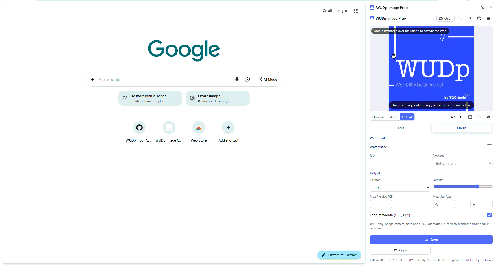
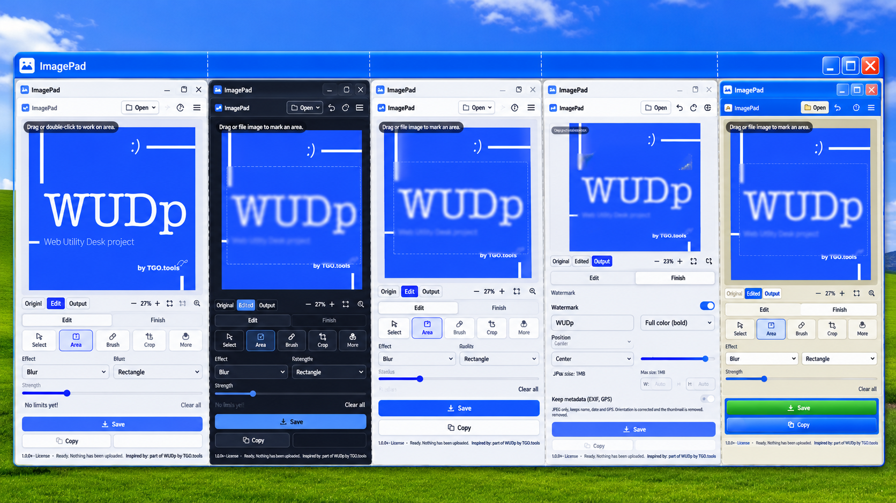

<div align="center">

# ImagePad

**Prepare images for upload, right beside the page you are on.**

Part of **WUDp** by **TGO.tools**




</div>

---

## Why ImagePad

You often need to upload a picture to a website, but it needs a small change first: a different crop, a blurred face, or a smaller file. Opening a large editor for a small job is too much work.

ImagePad runs beside the site, in the browser's side panel. You make the change with little effort, drag the result into the site, and never leave the browser. Nothing is uploaded anywhere.

---

## Features

- **Crop** to a free area, or to common site frames: profile photos, square and portrait posts, stories, video thumbnails, banners and more. In a fixed frame, the image moves under the frame, so you choose what stays inside.
- **Blur, pixelate or cover** a rectangle or an ellipse, or paint the same effects with a brush.
- **Watermark** with text, in a corner or tiled over the whole picture.
- **Output** as JPEG, WebP or PNG, with quality, a maximum file size and a maximum pixel size.
- **Metadata**: removed by default (camera, date, GPS). You can keep it for JPEG files when you need it.
- **Send it**: drag the finished image straight into a page, copy it as PNG, or save it.
- **Private**: nothing is uploaded. No analytics, no account.
- **Guided tour** on the first start, with a demo image so every step points at a real control.
- **Settings**: language (English, Russian, Persian, Chinese), theme (Modern, Dark, Luna XP), larger controls, hints, reduced motion, start tool and start view.

## Screenshots



---

## Install

### From the stores

| Store | Download |
| --- | --- |
| Chrome Web Store | Coming soon |
| Microsoft Edge Add-ons | Coming soon |
| Firefox Add-ons (AMO) | Coming soon |

### From the release ZIP (until the stores are live)

Download the ZIP for your browser from `dist/`:

- `dist/imagepad-chrome-1.2.4.zip`
- `dist/imagepad-edge-1.2.4.zip`
- `dist/imagepad-firefox-1.2.4.zip`

Debug builds with verbose logs: `dist/imagepad-<browser>-1.2.4-debug.zip`. See [Debug build](#debug-build).

**Chrome:** open `chrome://extensions`, turn on Developer mode, click Load unpacked, and select the unpacked folder. Requires Chrome 116 or newer.

**Edge:** open `edge://extensions`, turn on Developer mode, and click Load unpacked. Requires Edge 116 or newer. If the browser has no side panel, ImagePad opens in a tab.

**Firefox:** open `about:debugging#/runtime/this-firefox`, click Load Temporary Add-on, and select `manifest.json` inside the unpacked folder. Requires Firefox 128 or newer.

---

## How to use

1. Open ImagePad: click the toolbar button, or right-click an image on a page and choose **Edit with ImagePad**.
2. **Edit** tab: pick a tool (Select, Area, Brush, Crop, Move) and drag on the image. Use the zoom buttons or the mouse wheel.
3. **Finish** tab: add a watermark, and choose the format, quality and size. Hover the image to see the hint.
4. Drag the image into the page, or use **Copy** or **Save**.

Shortcuts: `V` select, `R` area, `B` brush, `C` crop, `H` move, `Ctrl+Z` undo, `Ctrl+Shift+Z` redo, `Ctrl+S` save, `Delete` removes the selected area.

---

## Build from source

ImagePad has **no runtime dependencies**. You need Node.js 20 or newer.

```bash
git clone https://github.com/WUDp-TGOtools/imagepad.git
cd imagepad
npm test          # unit tests for the pure logic
npm run check     # validates the manifests, referenced files and JavaScript syntax
npm run build     # builds dist/chrome, dist/edge and dist/firefox, plus one ZIP per browser
```

To build one browser only: `npm run build:chrome`, `npm run build:edge` or `npm run build:firefox`.

To try a build while developing, load `dist/<browser>` with the steps in [Install](#install). After a change, run `npm run build` again and reload the extension.

### One source, three browsers

`src/` is the only source of the extension. Browser differences live in `manifests/`:

- `manifests/base.json`: fields shared by all browsers.
- `manifests/chrome.json`: side panel and service worker.
- `manifests/edge.json`: like Chrome, with a runtime fallback (a tab when there is no side panel).
- `manifests/firefox.json`: Firefox id, sidebar and background scripts.

`scripts/build.mjs` merges them with `package.json` (for the version) and writes one folder and one ZIP per browser.


### Debug build

Two kinds of build are produced:

- **Normal** (`npm run build`): logging is off, errors are still reported.
- **Debug** (`npm run build:debug`, or `build:debug:chrome`, `build:debug:edge`, `build:debug:firefox`): the extension is named *ImagePad (Debug)* and logs drag and drop events, worker timings, previews and exports to the console. Settings then shows a **Copy debug log** button.

To read the log: open the extension's Inspect view (Chrome: `chrome://extensions` → Inspect views; Firefox: `about:debugging` → Inspect; or right-click the side panel → Inspect), then open the Console and filter by `[ImagePad]`.

---

## Releases

1. Update `version` in `package.json` and add an entry to `CHANGELOG.md`.
2. Run `npm test`, `npm run check` and `npm run build`. The builds are written to `dist/`. Write the release notes in `dist/posts/`.
3. Commit, then tag and push: `git tag vX.Y.Z && git push --tags`.

The **release workflow** (`.github/workflows/release.yml`) checks that the tag matches `package.json`, builds all browsers, attaches the ZIPs to a GitHub release, signs the Firefox build when the AMO secrets exist, and uploads to the Chrome Web Store when the CWS secrets exist.

Release posts for the current version are in `dist/posts/`:
- `github-release-1.2.0.md`: the GitHub release text (write a new one for each release).
- `short-announcement.md`: a short post for social media.
- `store-whats-new-1.2.0.md`: the "What's new" text for the stores.

Store listing texts are in `store/`.

---

## Privacy

- Nothing leaves your device. ImagePad makes no network requests, has no analytics and no account.
- Images stay in memory only while the panel or tab is open.
- Stored on the device: your tool and output settings, theme, language and tour progress.
- Permissions: side panel (the editor), context menu (Edit with ImagePad), and storage (settings). ImagePad has no access to web pages.
- Metadata (EXIF: camera, date, GPS) is removed by default. Keeping it is optional, and it can reveal where a photo was taken, so keep it only when you need it.

The full privacy text is in the Settings tab of the extension.

---

## Project structure

```
imagepad/
├── .github/  # CI and release workflows
│   └── workflows/
│       ├── ci.yml
│       └── release.yml
├── CHANGELOG.md  # release history
├── LICENSE  # MIT license
├── README.md  # this file
├── dist/  # release builds and release posts
│   ├── chrome/  # unpacked build
│   │   └── …  (same layout as src/, plus manifest.json)
│   ├── chrome-debug/  # unpacked build
│   │   └── …  (same layout as src/, plus manifest.json)
│   ├── edge/  # unpacked build
│   │   └── …  (same layout as src/, plus manifest.json)
│   ├── edge-debug/  # unpacked build
│   │   └── …  (same layout as src/, plus manifest.json)
│   ├── firefox/  # unpacked build
│   │   └── …  (same layout as src/, plus manifest.json)
│   ├── firefox-debug/  # unpacked build
│   │   └── …  (same layout as src/, plus manifest.json)
│   ├── imagepad-chrome-1.2.4-debug.zip
│   ├── imagepad-chrome-1.2.4.zip
│   ├── imagepad-edge-1.2.4-debug.zip
│   ├── imagepad-edge-1.2.4.zip
│   ├── imagepad-firefox-1.2.4-debug.zip
│   ├── imagepad-firefox-1.2.4.zip
│   └── posts/
│       ├── github-release-1.2.0.md
│       ├── short-announcement.md
│       └── store-whats-new-1.2.0.md
├── docs/  # README images
│   └── images/
├── manifests/  # per-browser manifest overlays
│   ├── base.json
│   ├── chrome.json
│   ├── edge.json
│   └── firefox.json
├── package.json  # version and npm scripts
├── scripts/  # build, checks and zip writer
│   ├── build.mjs
│   ├── check.mjs
│   ├── lib.mjs
│   └── zip.mjs
├── src/  # the extension (single source)
│   ├── background.js
│   ├── editor/
│   │   ├── assets/
│   │   │   └── demo.jpg
│   │   ├── editor.css
│   │   ├── index.html
│   │   └── src/  # the extension (single source)
│   │       ├── browser.js
│   │       ├── build-flags.js
│   │       ├── debug.js
│   │       ├── editor.js
│   │       ├── effects.js
│   │       ├── exif.js
│   │       ├── i18n.js
│   │       ├── icons.js
│   │       ├── ops.js
│   │       ├── pipeline.js
│   │       ├── presets.js
│   │       ├── render.worker.js
│   │       ├── storage.js
│   │       └── tour.js
│   └── icons/
│       ├── icon-128.png
│       ├── icon-16.png
│       ├── icon-32.png
│       ├── icon-48.png
│       └── icon-96.png
├── store/  # store listing texts
│   ├── chrome-web-store.md
│   ├── edge-add-ons.md
│   └── firefox-amo.md
└── tests/  # unit tests
    ├── background.test.mjs
    ├── effects.test.mjs
    ├── exif.test.mjs
    ├── i18n.test.mjs
    ├── ops.test.mjs
    └── pipeline.test.mjs
```

---

## Testing

```bash
npm test
```

The unit tests cover the pure logic: geometry and crop frames, the size search, masks and compositing, blur and pixelate (the optimized blur is checked against a naive reference), EXIF handling, and the translation dictionary (every key in every language, and every key used in the HTML and JavaScript).

The **user interface** is not covered by automated tests yet. Test it by hand in each browser with the checklist below.

### Manual checklist

- [ ] Open an image from the panel, from the context menu, and by pasting (Ctrl+V).
- [ ] Area blur, pixelate and color cover (rectangle and ellipse); brush; undo and redo.
- [ ] Crop: free draw, a site frame (move the image under the frame), a custom ratio, apply and remove.
- [ ] Finish: watermark (corner and tiled), format, quality, maximum size, and keep metadata on a JPEG with GPS (check with an EXIF viewer).
- [ ] Drag the finished image into a file input or a drop zone; copy; save.
- [ ] Guided tour on first start, from the help button, and from Settings. Skip it once.
- [ ] Settings persist after closing and reopening; language and theme switch (including right-to-left layout in Persian).

---

## Roadmap and next steps

- **Workflow:** combine crop and output into one step; keep the last crop frame between images; quick presets for common sites.
- **Brush:** an eraser; softer edges for blur.
- **Bugs:** collect reports from Chrome, Edge and Firefox. The first priority is drag-and-drop into real sites.
- **Performance:** measure on Firefox and Edge; use a smaller working size on slow machines.
- **Metadata:** keep XMP and color profiles for JPEG output.
- **Quality:** automated UI tests (Playwright) for the main flows; a signed Firefox release.
- **Stores:** publish on the Chrome Web Store, Edge Add-ons and AMO, with localized store texts.

Ideas and bug reports are welcome in the issues of the organization repository.

---

## License

ImagePad is released under the [MIT License](LICENSE).

---

<div align="center">

**ImagePad** · part of **WUDp** · by **TGO.tools**

[TGO on GitHub](https://github.com/TGO-root) · [WUDp organization](https://github.com/WUDp-TGOtools)

</div>
